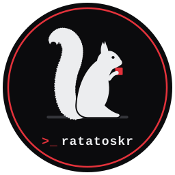

<p align="center">
  _ haszerobyte: small, fast tools for AI agents, written in Rust">
</p>

<p align="center">
  <a href="https://github.com/haszerobyte/Ratatoskr"></a>
  
  
</p>

### >_ Hi, I'm haszerobyte

I build the plumbing that lets coding agents (Claude Code, Codex, Cursor, …)
reach the outside world. My rules for it:

- **Lean.** One small binary that starts instantly and idles at a few megabytes.
- **No keys if avoidable.** It works out of the box; paid APIs are optional fallbacks.
- **Polite.** Paces itself per site and backs off when a site says no.
- **Safe by default.** Never lets an agent reach into your local network.

### >_ Featured: ratatoskr

<table>
  <tr>
    <td width="180" align="center">
      <a href="https://github.com/haszerobyte/Ratatoskr">
        
      </a>
    </td>
    <td>
      <a href="https://github.com/haszerobyte/Ratatoskr"><b>ratatoskr</b></a>:
      web search and page fetching for AI agents, in pure Rust, with no API key.
      <br><br>
      <ul>
        <li><code>web_search</code>: a meta-search over Yahoo, DuckDuckGo, Bing and Yandex for web pages, news, images, videos and books</li>
        <li><code>web_fetch</code>: pages and PDFs as clean text with their links kept</li>
        <li>An MCP server, a CLI and a Rust library, all in one 10&nbsp;MB binary</li>
      </ul>
      <a href="https://crates.io/crates/ratatoskr-web"></a>
      <a href="https://docs.rs/ratatoskr-web"></a>
      <a href="https://github.com/haszerobyte/Ratatoskr/releases"></a>
      <a href="https://github.com/haszerobyte/Ratatoskr/stargazers"></a>
    </td>
  </tr>
</table>

Compared with the reference MCP fetch server, run as MCP servers:

| | ratatoskr | [mcp-server-fetch](https://github.com/modelcontextprotocol/servers/tree/main/src/fetch) |
|---|---|---|
| ready to answer | **0.01 s** | 3.58 s |
| memory at idle | **6 MB** | 95 MB |
| memory after the calls | **44 MB** | 143 MB |

#### Add it to your agent

Install it from the [releases](https://github.com/haszerobyte/Ratatoskr/releases),
or with `cargo install ratatoskr-web --locked`. Then:

<details>
<summary><b>Claude Code</b></summary>

```sh
claude mcp add ratatoskr -- ratatoskr mcp
```
</details>

<details>
<summary><b>Codex</b> (<code>~/.codex/config.toml</code>)</summary>

```toml
[mcp_servers.ratatoskr]
command = "ratatoskr"
args = ["mcp"]
```
</details>

<details>
<summary><b>Claude Desktop, Cursor</b> and most other clients</summary>

```json
{
  "mcpServers": {
    "ratatoskr": { "command": "ratatoskr", "args": ["mcp"] }
  }
}
```
</details>

<details>
<summary><b>VS Code</b> (<code>.vscode/mcp.json</code>)</summary>

```json
{
  "servers": {
    "ratatoskr": { "type": "stdio", "command": "ratatoskr", "args": ["mcp"] }
  }
}
```
</details>

Or try it in a terminal:

```sh
ratatoskr search "tokio select macro"
ratatoskr fetch https://www.rust-lang.org/
```

### >_ Tools I use

<p>
  
</p>

### >_ Get in touch

Found a bug or have an idea? [Open an issue](https://github.com/haszerobyte/Ratatoskr/issues)
on ratatoskr. Stars are welcome too ⭐
